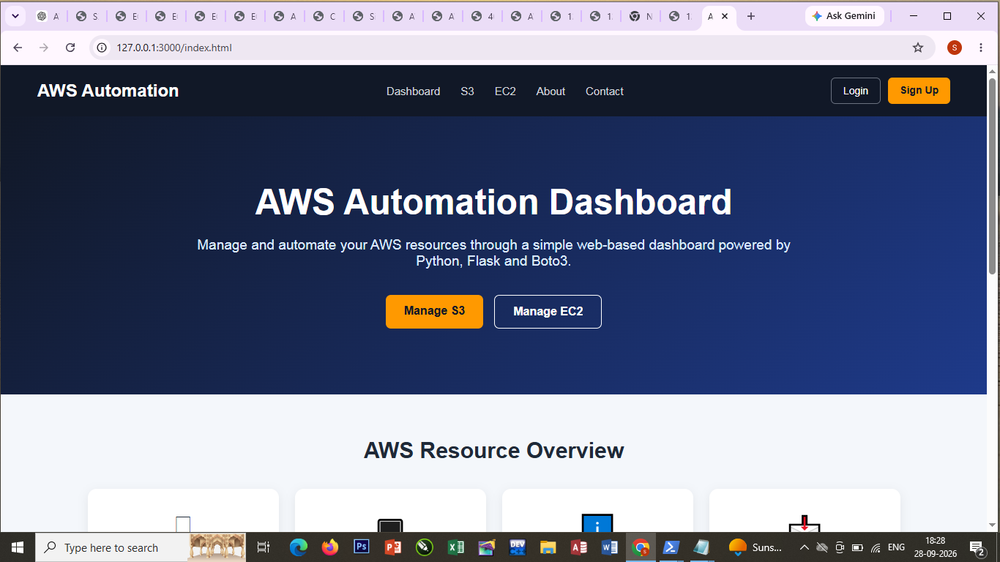
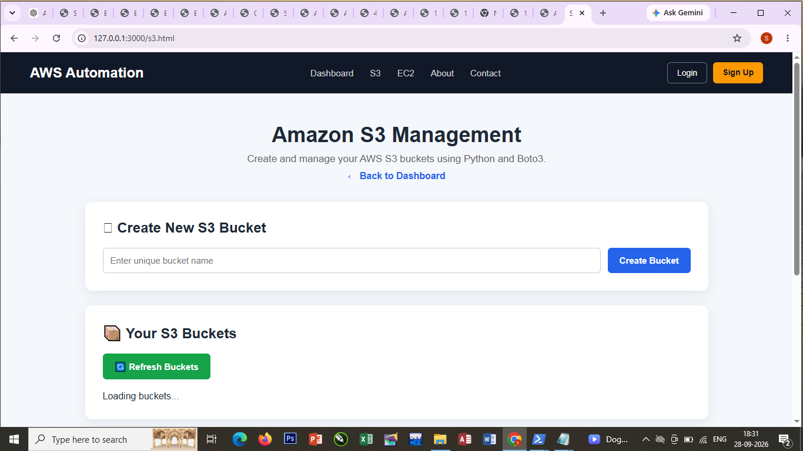
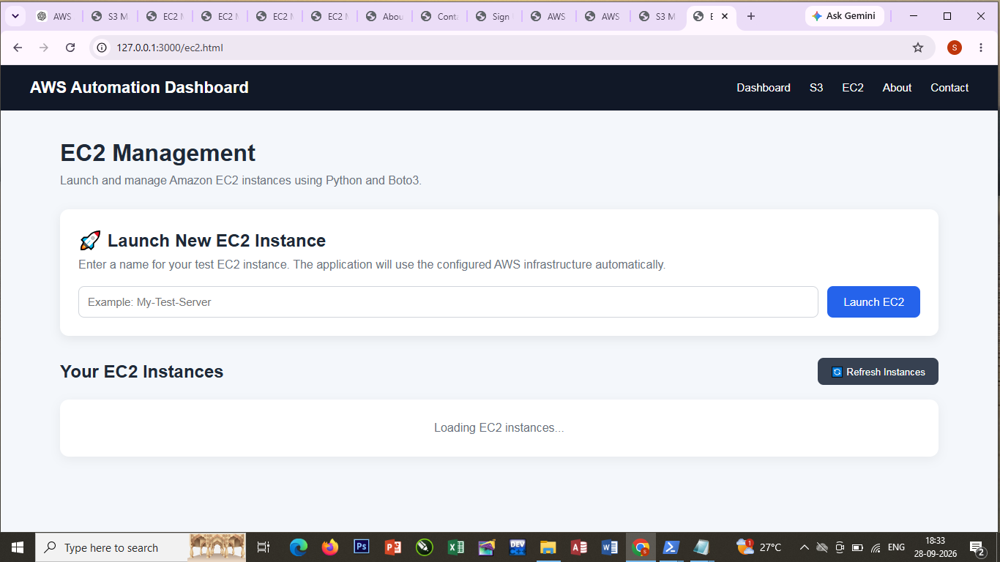
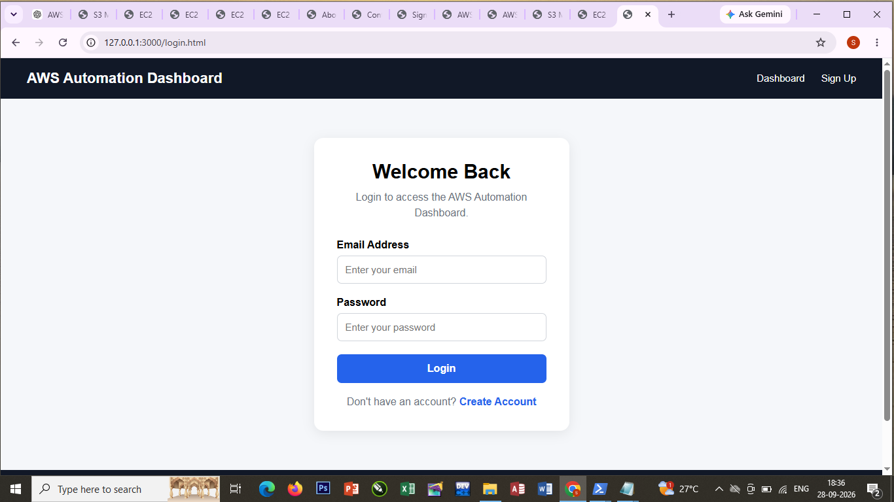
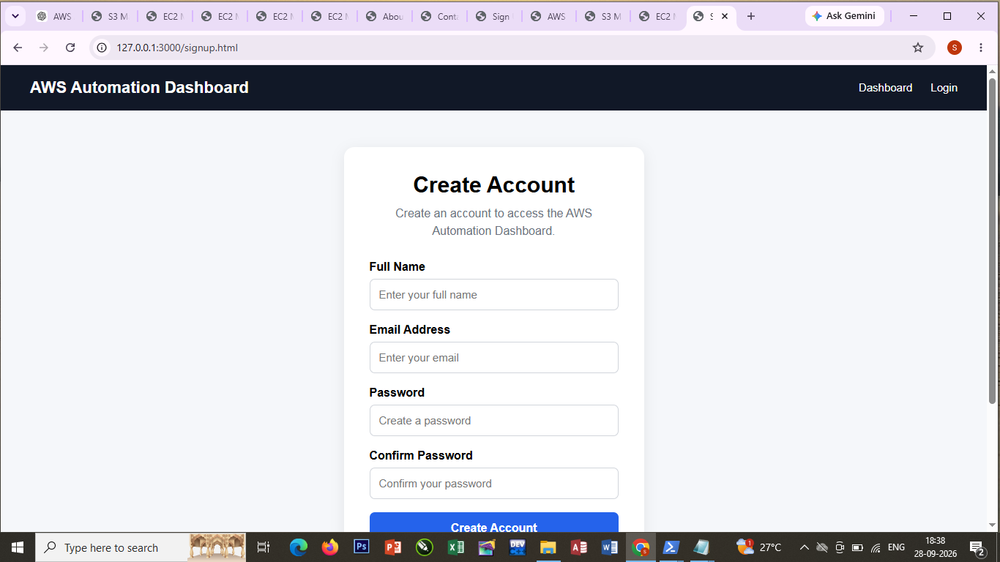
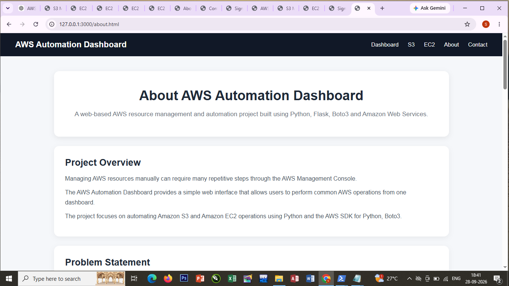
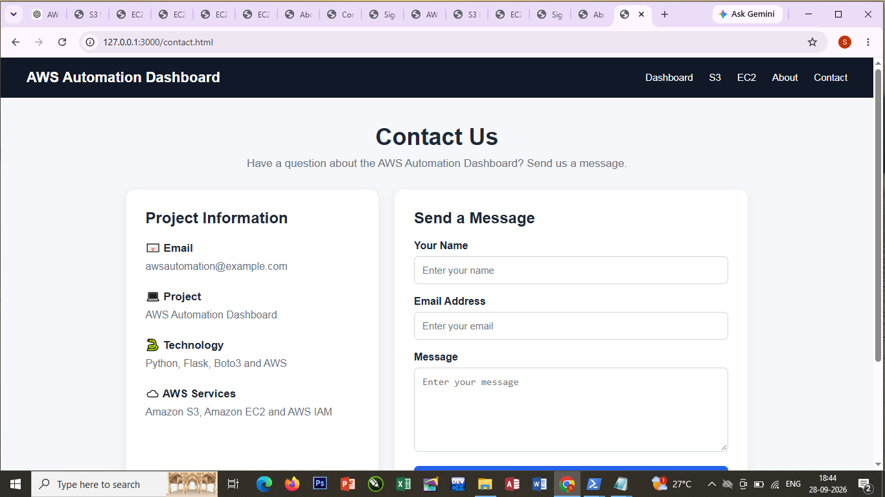

# AWS Automation Dashboard Using Python and Boto3

A web-based AWS automation dashboard that allows users to manage Amazon S3 buckets, files, and Amazon EC2 instances through a simple and user-friendly interface.

The project uses **Python, Flask, Boto3, HTML, CSS, JavaScript, and AWS IAM** to automate common AWS operations without requiring users to perform every task manually through the AWS Management Console.

---

## 📌 Project Overview

Managing AWS resources manually can require multiple steps through the AWS Management Console. This project provides a simple web-based dashboard where common AWS operations can be performed from one place.

The dashboard communicates with a Python Flask backend. The backend uses the AWS SDK for Python (**Boto3**) to communicate securely with AWS services.

### Main workflow

**User → Web Dashboard → Flask API → Boto3 → AWS IAM → S3 / EC2**

---

## 🎯 Problem Statement

AWS resource management often involves repetitive manual operations such as:

* Creating S3 buckets
* Uploading files
* Viewing stored files
* Downloading files
* Deleting files
* Launching EC2 instances
* Starting EC2 instances
* Stopping EC2 instances
* Terminating EC2 instances

These operations can be automated using Python and Boto3.

---

## 💡 Proposed Solution

The AWS Automation Dashboard provides a centralized web interface for performing common AWS operations.

The user interacts with the frontend, while the Flask backend processes the requests and uses Boto3 to perform the required AWS operations.

This demonstrates how cloud resources can be managed programmatically using the AWS SDK.

---

## 🚀 Project Objectives

* Automate common AWS resource management tasks.
* Build a web-based AWS management dashboard.
* Use Python and Boto3 for AWS automation.
* Implement REST API endpoints using Flask.
* Manage Amazon S3 buckets and files.
* Manage Amazon EC2 instances.
* Use IAM permissions to control AWS access.
* Build a clean and beginner-friendly cloud automation project.

---

## 🛠️ Technologies Used

### Programming Languages

* Python
* HTML
* CSS
* JavaScript

### Frameworks and Libraries

* Flask
* Flask-CORS
* Boto3

### Cloud Services

* Amazon S3
* Amazon EC2
* AWS IAM

### Development Tools

* AWS CLI
* Visual Studio Code / Notepad
* PowerShell
* Python Virtual Environment

---

# ☁️ AWS Services Used

## 1. Amazon S3

Amazon S3 is used for cloud storage.

The dashboard can:

* List S3 buckets
* Create S3 buckets
* List files inside a bucket
* Upload files
* Download files
* Delete files

---

## 2. Amazon EC2

Amazon EC2 provides virtual servers in AWS.

The dashboard can:

* View EC2 instances
* Launch an EC2 instance
* Start an instance
* Stop an instance
* Terminate an instance

---

## 3. AWS IAM

AWS IAM controls access to AWS resources.

IAM permissions are used to allow the Python application to perform the required S3 and EC2 operations.

The project does not store AWS access keys inside the source code.

---

# 🏗️ System Architecture

```text
                    ┌─────────────────────┐
                    │       User          │
                    └──────────┬──────────┘
                               │
                               ▼
                    ┌─────────────────────┐
                    │   Web Dashboard     │
                    │ HTML/CSS/JavaScript │
                    └──────────┬──────────┘
                               │
                               ▼
                    ┌─────────────────────┐
                    │    Flask Backend    │
                    │     REST APIs       │
                    └──────────┬──────────┘
                               │
                               ▼
                    ┌─────────────────────┐
                    │       Boto3         │
                    │    AWS SDK Python   │
                    └──────────┬──────────┘
                               │
                     ┌─────────┴─────────┐
                     │                   │
                     ▼                   ▼
              ┌─────────────┐     ┌─────────────┐
              │     S3      │     │     EC2     │
              │   Storage   │     │   Compute   │
              └─────────────┘     └─────────────┘
```

---

# 🔄 Application Workflow

### S3 workflow

```text
User
 ↓
S3 Dashboard
 ↓
Flask API
 ↓
Boto3
 ↓
AWS IAM
 ↓
Amazon S3
 ↓
Operation Result
 ↓
Dashboard
```

### EC2 workflow

```text
User
 ↓
EC2 Dashboard
 ↓
Flask API
 ↓
Boto3
 ↓
AWS IAM
 ↓
Amazon EC2
 ↓
Operation Result
 ↓
Dashboard
```

---

# ✨ Main Features

## Amazon S3 Automation

* View all available S3 buckets
* Create a new S3 bucket
* Select a bucket
* View files inside a bucket
* Upload files
* Download files
* Delete files

## Amazon EC2 Automation

* View EC2 instances
* Launch EC2 instances
* Start stopped instances
* Stop running instances
* Terminate instances
* Display instance ID
* Display instance type
* Display instance state

## Dashboard

The main dashboard provides an overview of AWS resources.

It displays:

* Number of S3 buckets
* Number of EC2 instances
* Navigation to S3 and EC2 management
* Project information
* Contact page

## Additional Pages

The project also contains:

* Login page
* Sign Up page
* About page
* Contact page
* Custom 404 page

> Note: Login and Sign Up are frontend demonstration pages. They do not implement production authentication.

---

# 📁 Project Structure

```text
AWS-Automation-Boto3/
│
├── backend/
│   ├── app.py
│   ├── s3_service.py
│   ├── ec2_service.py
│   └── requirements.txt
│
├── frontend/
│   ├── index.html
│   ├── login.html
│   ├── signup.html
│   ├── s3.html
│   ├── ec2.html
│   ├── about.html
│   ├── contact.html
│   ├── 404.html
│   │
│   ├── css/
│   │   └── style.css
│   │
│   └── js/
│       └── app.js
│
├── screenshots/
│   ├── dashboard.png
│   ├── s3.png
│   ├── ec2.png
│   ├── login.png
│   ├── signup.png
│   ├── about.png
│   └── contact.png
│
├── README.md
├── requirements.txt
└── .gitignore
```

---

# 🔧 Backend API Endpoints

## General

| Method | Endpoint  | Purpose              |
| ------ | --------- | -------------------- |
| GET    | `/`       | Check API status     |
| GET    | `/health` | Check backend health |

## S3

| Method | Endpoint       | Purpose       |
| ------ | -------------- | ------------- |
| GET    | `/s3/buckets`  | List buckets  |
| POST   | `/s3/buckets`  | Create bucket |
| GET    | `/s3/files`    | List files    |
| POST   | `/s3/upload`   | Upload file   |
| GET    | `/s3/download` | Download file |
| DELETE | `/s3/delete`   | Delete file   |

## EC2

| Method | Endpoint                       | Purpose            |
| ------ | ------------------------------ | ------------------ |
| GET    | `/ec2/instances`               | List instances     |
| POST   | `/ec2/launch`                  | Launch instance    |
| POST   | `/ec2/start/<instance_id>`     | Start instance     |
| POST   | `/ec2/stop/<instance_id>`      | Stop instance      |
| POST   | `/ec2/terminate/<instance_id>` | Terminate instance |

---

# ⚙️ Implementation Steps

## Step 1 — Configure AWS

Configure the AWS CLI with an IAM user that has the required permissions.

Set the AWS region to:

```text
ap-south-1
```

Verify the AWS CLI configuration:

```powershell
aws sts get-caller-identity
```

---

## Step 2 — Create Python Virtual Environment

Create a virtual environment:

```powershell
python -m venv venv
```

Activate it:

```powershell
.\venv\Scripts\Activate.ps1
```

---

## Step 3 — Install Dependencies

Install the required Python packages:

```powershell
pip install flask flask-cors boto3
```

The project dependencies are also stored in:

```text
requirements.txt
```

---

## Step 4 — Start the Backend

Open PowerShell and run:

```powershell
cd "C:\Users\Saanchi\Desktop\AWS-Automation-Boto3\backend"
..\venv\Scripts\Activate.ps1
python app.py
```

The backend runs on:

```text
http://127.0.0.1:5000
```

---

## Step 5 — Start the Frontend

Open another PowerShell window:

```powershell
cd "C:\Users\Saanchi\Desktop\AWS-Automation-Boto3\frontend"
python -m http.server 3000
```

The frontend runs on:

```text
http://127.0.0.1:3000
```

Open the dashboard in a browser:

```text
http://127.0.0.1:3000/index.html
```

---

# 🖼️ Screenshots

## Dashboard



## S3 Management



## EC2 Management



## Login Page



## Sign Up Page



## About Page



## Contact Page



---

# 🔐 Security

Security was considered during project development.

### IAM

The project uses IAM permissions to control access to AWS services.

### Credentials

AWS credentials are not hardcoded inside Python source files.

### Git Protection

The `.gitignore` file prevents sensitive files and local configuration from being committed.

Examples include:

```text
.env
.aws/
credentials
config
venv/
__pycache__/
```

### Important

Never upload AWS access keys, secret keys, passwords, or other credentials to GitHub.

---

# 🧪 Testing

The project was tested using both the web dashboard and AWS CLI.

### S3 testing

The following operations were tested:

* Bucket creation
* Bucket listing
* File upload
* File listing
* File download
* File deletion

### EC2 testing

The following operations were tested:

* Instance listing
* Instance launch
* Instance start
* Instance stop
* Instance termination

### API testing

The Flask API was tested using browser endpoints such as:

```text
/s3/buckets
/ec2/instances
/health
```

---

# 📊 Project Benefits

This project demonstrates practical knowledge of:

* Python programming
* Flask web development
* REST APIs
* AWS SDK
* Boto3
* Amazon S3
* Amazon EC2
* AWS IAM
* Cloud automation
* Frontend development
* Backend development
* AWS CLI
* Basic cloud security

---

# 📚 What I Learned

Through this project, I learned how to:

1. Connect Python applications with AWS.
2. Use Boto3 to automate AWS resources.
3. Create REST APIs using Flask.
4. Work with Amazon S3 programmatically.
5. Manage EC2 instances using Python.
6. Configure IAM permissions.
7. Connect a frontend with a backend API.
8. Test AWS resources using AWS CLI.
9. Protect sensitive configuration files using `.gitignore`.
10. Build and document a complete cloud automation project.

---

# 🔮 Future Improvements

Possible future improvements include:

* Real user authentication
* User registration with a database
* AWS CloudWatch monitoring
* EC2 CPU utilization monitoring
* S3 search and filtering
* File type validation
* File size limits
* Better error notifications
* CloudFront deployment
* HTTPS deployment
* Role-based access control
* Production deployment on AWS

---

# 🎓 Capstone Project

This project was developed as an AWS cloud automation capstone project to demonstrate practical knowledge of cloud services, Python programming, AWS SDKs, APIs, and web development.

---

# 👩‍💻 Author

**Saanchi Narendra Padekar**

AWS Cloud / Python / Boto3 Project

---

# 📌 Conclusion

The AWS Automation Dashboard demonstrates how Python and Boto3 can be used to automate common AWS operations through a simple web interface.

The project combines frontend development, Flask REST APIs, AWS IAM, Amazon S3, and Amazon EC2 into one practical cloud automation application.

It provides hands-on experience with both AWS infrastructure management and application development.
